

  

<h1 align="center">MYKerawang</h1>

  A campus community app for students: posts, events, a student market and forms, in one place. 
  <a href="https://kerawang.my"><b>kerawang.my</b></a>

## Home and posts

The feed is the front page: what's happening, what's for sale, and what people are talking about.

| **Home feed** | **Post and comments** | **Create post** |
|:---:|:---:|:---:|
| 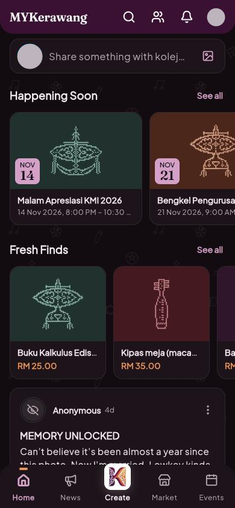 | 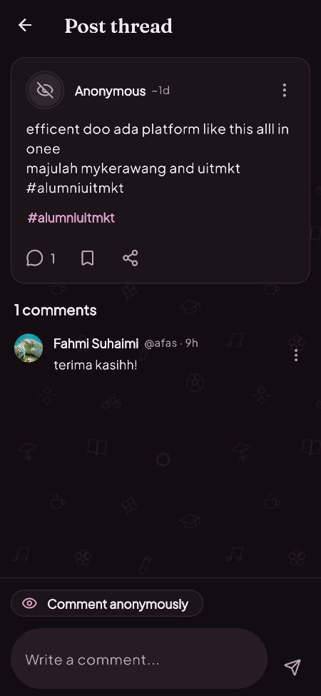 | 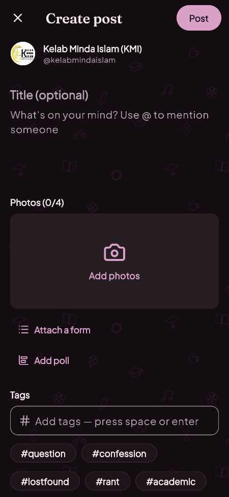 |
| • Scroll posts, upcoming events and new Market items in one feed • See pinned posts at the top • Share something quickly from the box at the top | • Read a post with its photos • Comment, @mention people and use #tags • Repost, save or share the post | • Write a post and add photos • Post anonymously • Add a poll with its own question |

## Polls

Ask the whole campus a question and see the answer in seconds.

| **Poll in the feed** | **What you can do** |
|:---:|:---|
| 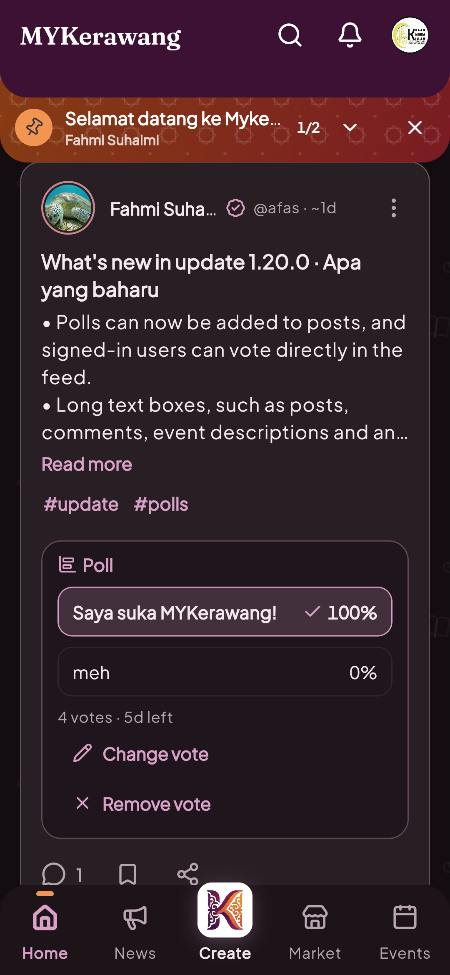 | • Add a poll to any post, with its own question • Pick a choice and tap Vote, straight from the feed • See the result bars with your pick ticked • Change or remove your vote while the poll is open |

## News and events

Official announcements and every event on campus, with reminders.

| **News** | **Events** | **Event page** |
|:---:|:---:|:---:|
| 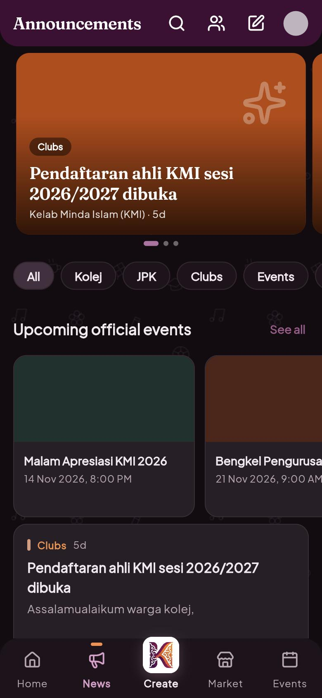 | 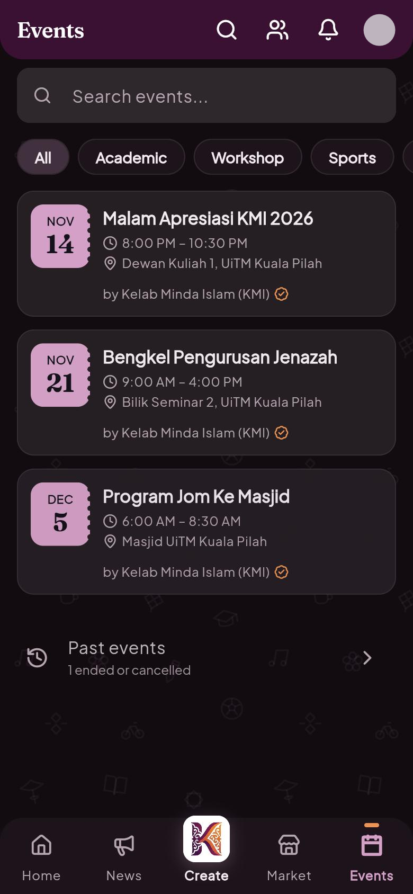 | 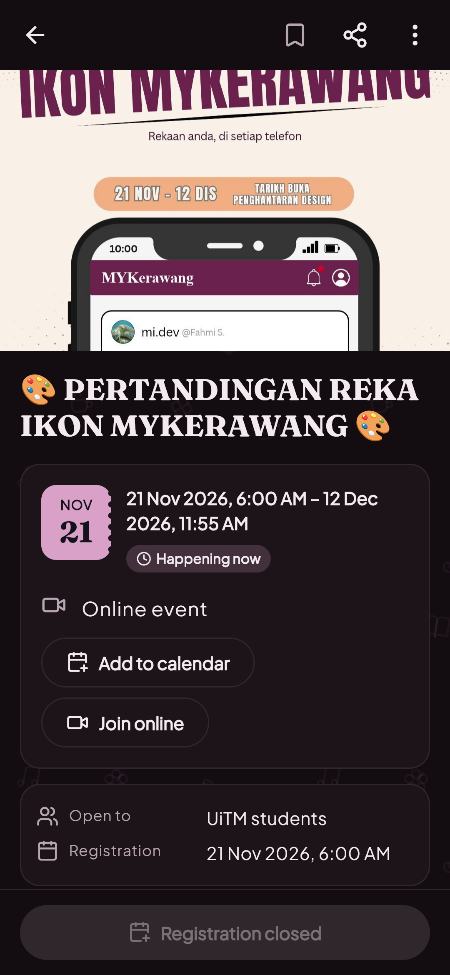 |
| • Read official announcements from the college, JPK and clubs • Filter by Kolej, JPK, Clubs or Events | • Browse upcoming events by category • Search events • See past events | • See date, time, place and organiser • Join, add to calendar or share • Open the organiser's registration or group link |

## Market

A student market: sell what you don't need, find what you do.

| **Market** | **Item page** | **Sell an item** |
|:---:|:---:|:---:|
| 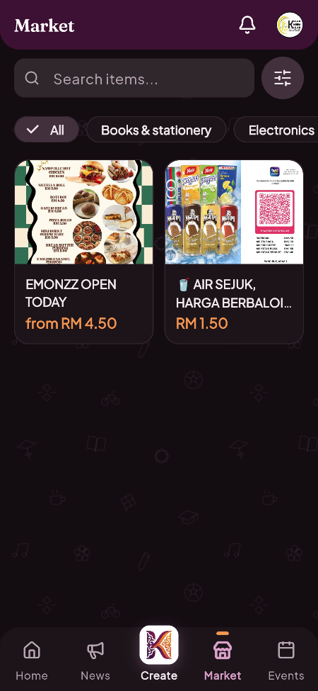 | 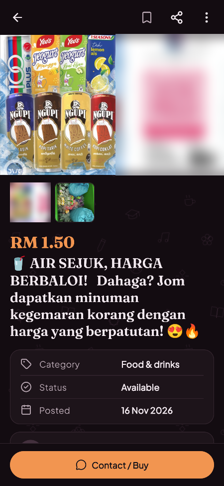 | 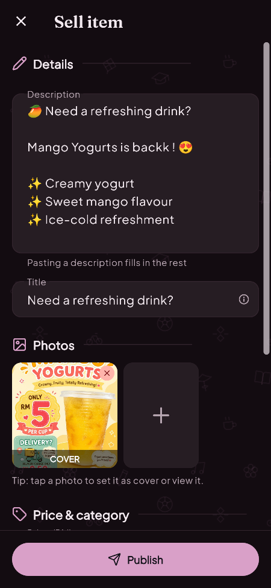 |
| • Browse items by category • See the lowest price on each card | • See photos, price list and availability • Chat the seller on WhatsApp • Share the item with a preview card | • Paste your WhatsApp ad: title, price and category fill in by themselves • Add a price list • Bump your item to the top every three days |

## Forms

Attendance, surveys and registrations without Google Forms.

| **My forms** | **Form editor** | **Responses** |
|:---:|:---:|:---:|
| 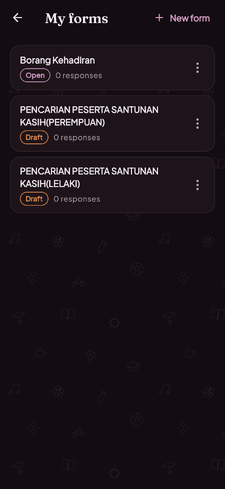 | 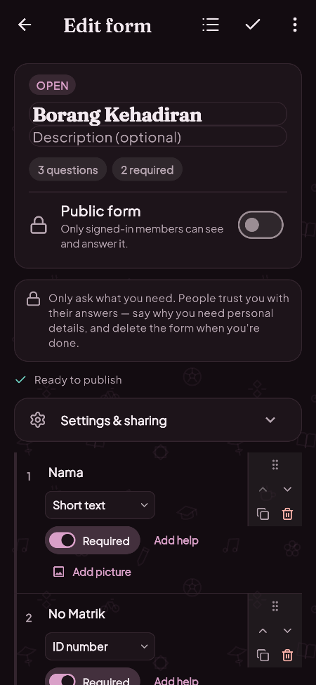 | 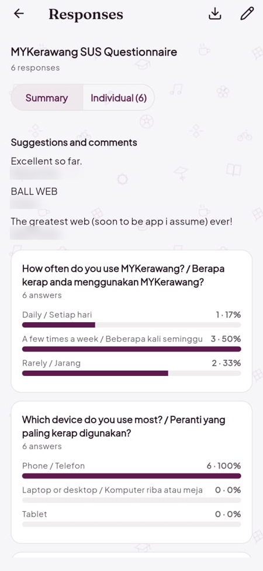 |
| • See your forms in one place • Start from scratch, a template or a Google Form link | • Add questions, dropdowns, scales, times and pictures • Set an opening time, colour and thank-you message • Get a short link and a QR code to print | • See answers as charts • Look at one person's answers at a time • Export to CSV |

## Profile and settings

Make the app your own.

| **Profile** | **Settings** |
|:---:|:---:|
| 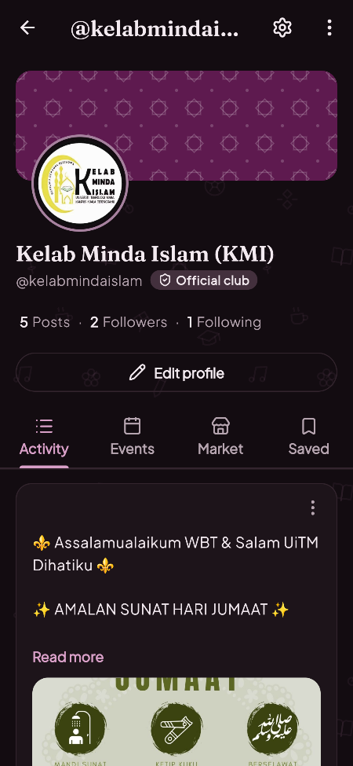 | 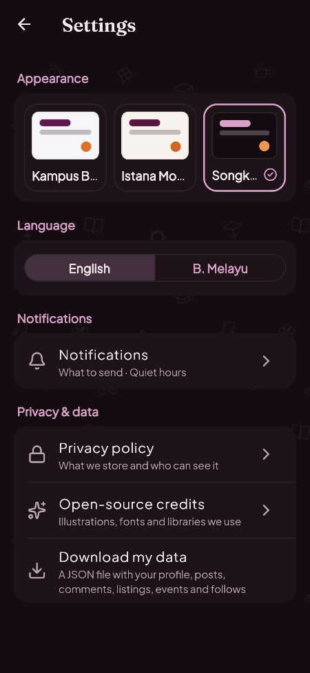 |
| • Photo, bio, posts, events and items • Follow people and see followers • Saved posts in one tab | • Three themes and two languages (English, Malay) • Choose which notifications reach your phone, with quiet hours • Download your data |

## Built with

- Flutter (web, compiled to WebAssembly; Android app in testing)
- Supabase (Postgres, auth, storage, row-level security)
- Firebase Hosting and Cloud Functions (link previews), Firebase Cloud Messaging (push)

## About this repository

This is a public showcase. The source code is kept in a private repository.

© 2026 MYKerawang. All rights reserved.
